# Secure Vault — Illustrated User Guide

[العربية](GUIDE.md) · [Printable PDF](GUIDE-en.pdf) · [Download the program](README.md)

A detailed, picture-by-picture walkthrough of every feature of Secure Vault for Windows: hiding and encrypting files, saving passwords, syncing with your phone, backups and settings. The red numbers in each picture match the steps written under it.

## Contents

1. [What is Secure Vault?](#about)
2. [First run: create your vault](#setup)
3. [Unlocking the vault](#unlock)
4. [Main screen: My Files](#files)
5. [Built-in video and audio player](#player)
6. [Saved Accounts (passwords)](#accounts)
7. [Adding or editing an account](#account_edit)
8. [Syncing accounts with your phone](#sync)
9. [Settings and linked devices](#settings)
10. [Backup and restore](#backup)
11. [Changing the PIN and the recovery key](#pin)
12. [Top bar: language, dark mode, updates](#topbar)
13. [License and free trial](#license)
14. [The phone app (Android and iPhone)](#mobile)
15. [Security: how your data is protected](#security)

## 1. What is Secure Vault?

Secure Vault is a private, encrypted place on your computer for your files and passwords. Everything you add is encrypted with AES-256 and hidden inside the vault folder, and only opens with your secret PIN. The program works offline and never uploads your files; the internet is used only to check for updates and, optionally, to sync your saved accounts with the phone app.

> **Tips:**
> - Comes in two editions: an installer (Setup) and a Portable edition that runs from any folder or USB stick — both have the same features.
> - Nothing else (such as Python) needs to be installed on your computer.

[↑ Back to contents](#contents)

---

## 2. First run: create your vault

The first time you run the program it asks you to create a secret PIN for the vault.

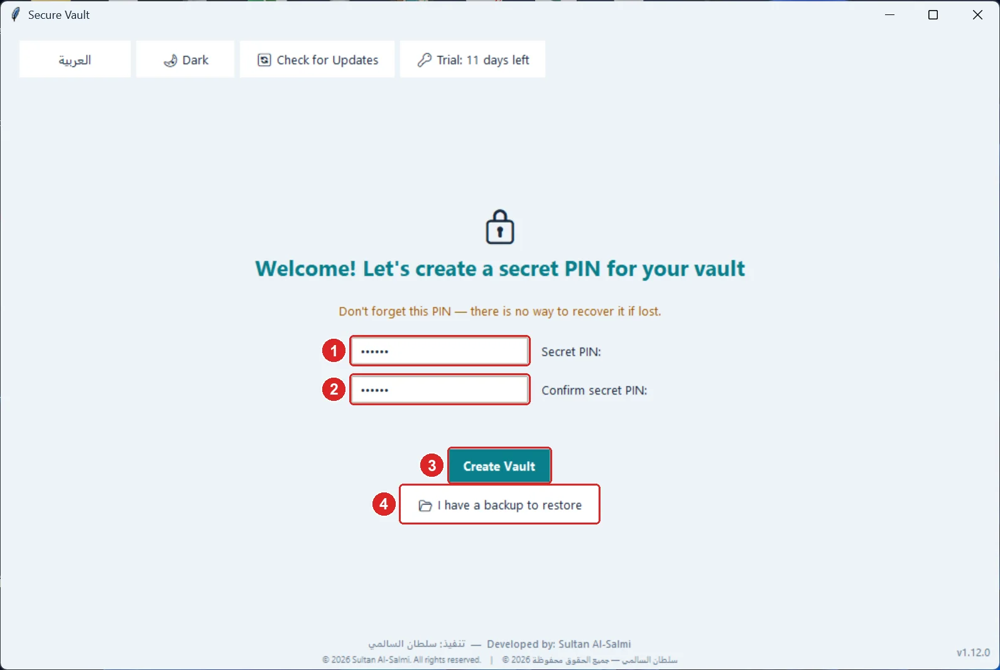

1. Type a secret PIN (at least 4 characters; longer is stronger).
2. Type the same PIN again to confirm it.
3. Press “Create Vault”.
4. If you have a backup of an earlier vault, press “I have a backup to restore” instead.

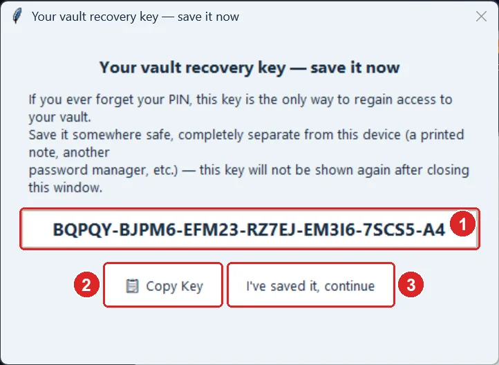

1. This is your “recovery key” — the only way to open the vault if you forget your PIN.
2. Press “Copy Key” and keep it somewhere safe, away from this computer (a printed note or another password manager).
3. Press “I've saved it, continue”. The key will not be shown again.

> **Tips:**
> - There is no way to open the vault without the PIN or the recovery key — not even the publisher can.

[↑ Back to contents](#contents)

---

## 3. Unlocking the vault

Each time you open the program (or after locking) the unlock screen appears.

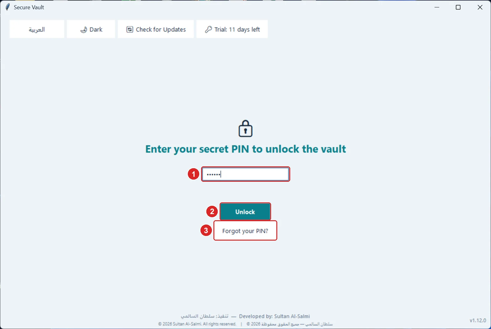

1. Type your secret PIN.
2. Press “Unlock” (or Enter).
3. Forgot it? Press “Forgot your PIN?”, enter your recovery key, then set a new PIN.

> **Tips:**
> - After 3 wrong attempts the program makes you wait a few seconds, longer after each mistake, to protect the vault against guessing.

[↑ Back to contents](#contents)

---

## 4. Main screen: My Files

This is where you hide files inside the vault, open them and take them out. The sidebar is the same on every screen.

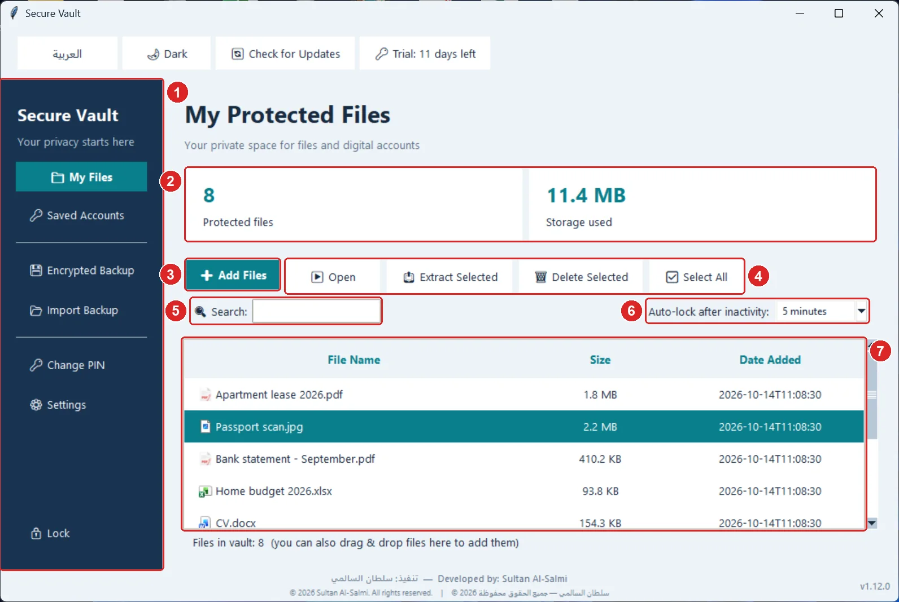

1. The sidebar: switch between “My Files”, “Saved Accounts” and “Settings”, plus backups, changing the PIN and locking.
2. How many files are protected and the space they use.
3. “Add Files”: choose one or more files to encrypt and hide. You can also drag files from Explorer and drop them on the window.
4. “Open” the selected file, “Extract Selected” to save a normal copy to a folder you choose, “Delete Selected” to remove it permanently, and “Select All”.
5. Search by file name.
6. Auto-lock: the vault locks itself after the idle time you choose (1, 5 or 15 minutes, or Off).
7. The file list: double-click a file to open it; click any column title to sort by it.

> **Tips:**
> - When adding, the program asks whether to delete the original files. Choose “Yes” so the file exists only inside the vault (it is overwritten before deletion, so recovery tools can't bring it back), or “No” to also keep a visible copy.
> - A file you open is decrypted into a temporary copy; pressing “Lock” closes and deletes these copies automatically — save your changes before locking.
> - Select several files with Ctrl or Shift + click, or Ctrl+A.

[↑ Back to contents](#contents)

---

## 5. Built-in video and audio player

Videos and audio play inside the vault window itself, so no copy is left behind in other programs.

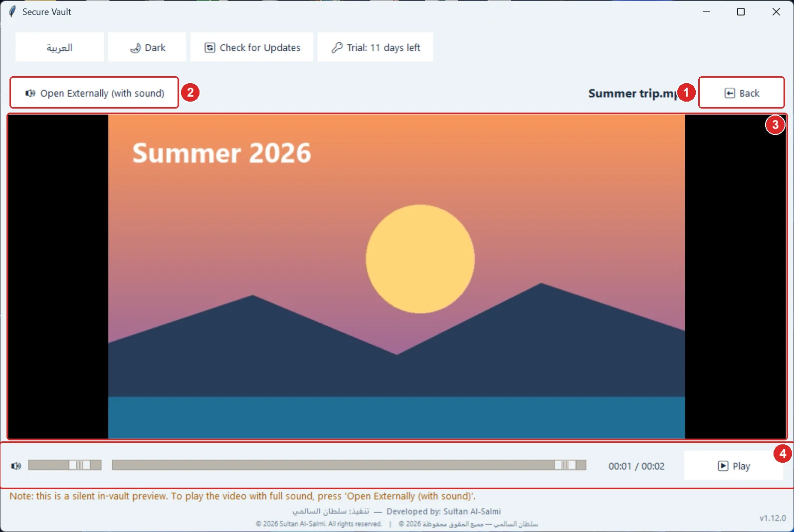

1. “Back” closes the player, deletes the temporary copy and returns to your files.
2. “Open Externally (with sound)” plays the video in a Windows player with full sound.
3. The video plays here (a silent preview).
4. The control bar: “Play/Pause”, the progress bar to jump to any moment, the time, and the volume.

> **Tips:**
> - Audio files (MP3 and others) play inside the vault with sound.
> - Pictures and documents open in the Windows program associated with their type.

[↑ Back to contents](#contents)

---

## 6. Saved Accounts (passwords)

Keep your website and app accounts and their passwords encrypted inside the vault.

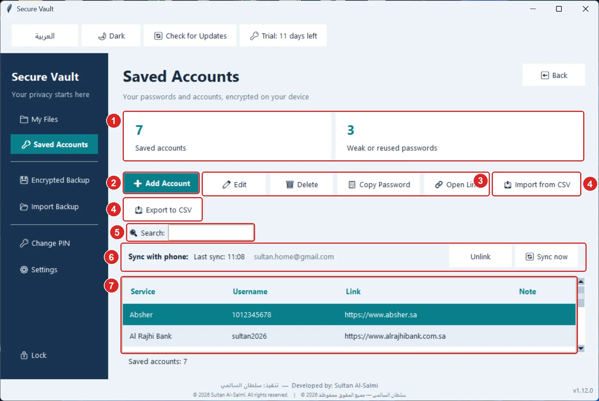

1. How many accounts you have, and how many passwords are weak or reused.
2. “Add Account”.
3. For the selected account: “Edit”, “Delete”, “Copy Password” (cleared from the clipboard after 45 seconds) and “Open Link” in the browser.
4. “Import from CSV” from a browser or another password manager, and “Export to CSV”.
5. Search by service, username or link.
6. Sync with your phone: its status, “Sync now” and “Unlink” (see the sync section).
7. The account list: double-click to edit. The “Note” column warns about a weak or reused password.

> **Tips:**
> - An exported CSV file is not encrypted and its passwords are readable — use it only to move them, then delete it.
> - Import accepts files from Chrome, Edge, Firefox and most password managers.

[↑ Back to contents](#contents)

---

## 7. Adding or editing an account

This screen opens from “Add Account” or “Edit”.

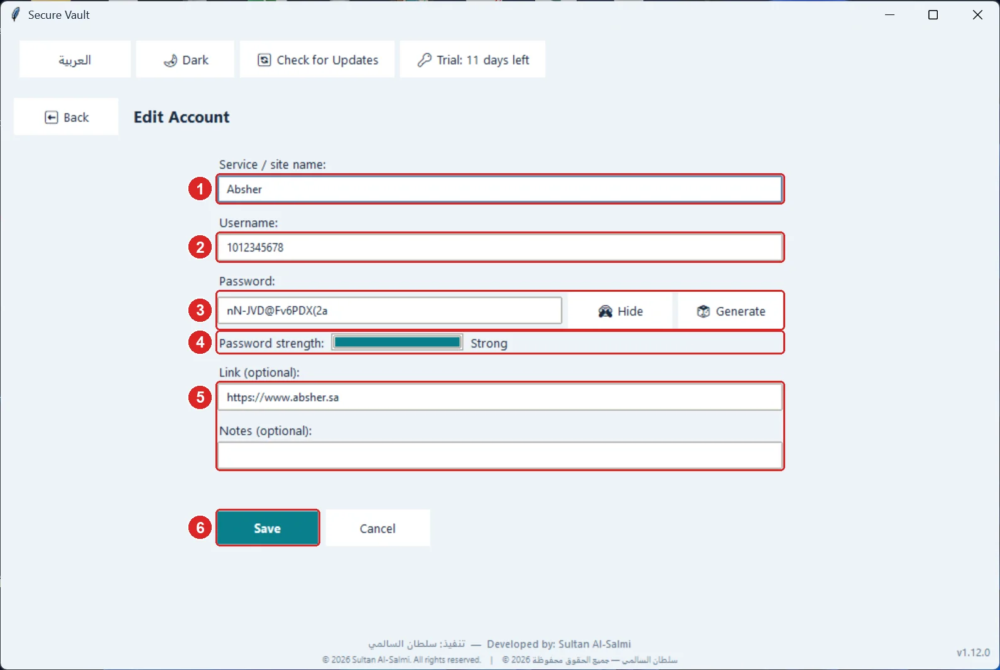

1. Service or site name (required).
2. Username or email.
3. Password: “Show” to see it, “Generate” to create a strong random password.
4. The password strength meter.
5. Link and notes (optional).
6. “Save”.

[↑ Back to contents](#contents)

---

## 8. Syncing accounts with your phone

Only saved accounts (not files) sync between the program and the Secure Vault phone app, through a single encrypted file in your own Google Drive. You link once from “Saved Accounts” → “Link Google account”.

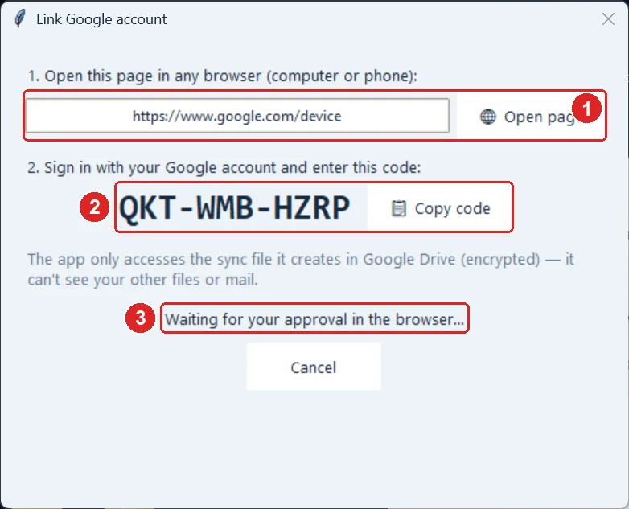

1. Open this page in any browser (it opens automatically on the computer).
2. Sign in with your Google account and enter this code (it is copied for you — just paste it).
3. Once you approve in the browser, the program continues by itself.

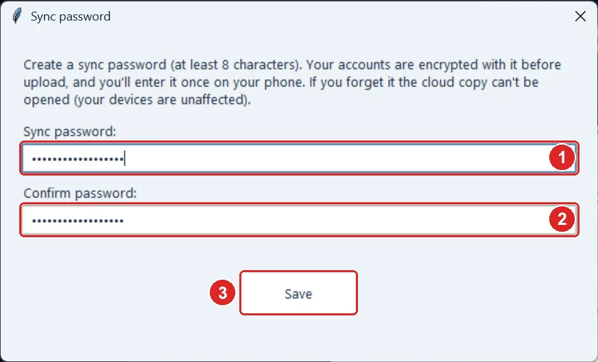

1. Create a “sync password” (at least 8 characters). Your accounts are encrypted with it before upload.
2. Type it again to confirm.
3. Press “Save”. On the phone, link the same Google account and enter the same sync password once.

> **Tips:**
> - The program only reaches the sync file it creates; it can't see your other Drive files or your email.
> - Google only ever sees encrypted data. If you forget the sync password the cloud copy can't be opened, but the accounts on your devices are unaffected.
> - Sync runs automatically after every change and every 5 minutes while the vault is open. The newest edit wins and deleted accounts stay deleted.
> - “Unlink” asks twice because it stops syncing between your devices.

[↑ Back to contents](#contents)

---

## 9. Settings and linked devices

“⚙ Settings” in the sidebar shows every device linked to your sync account.

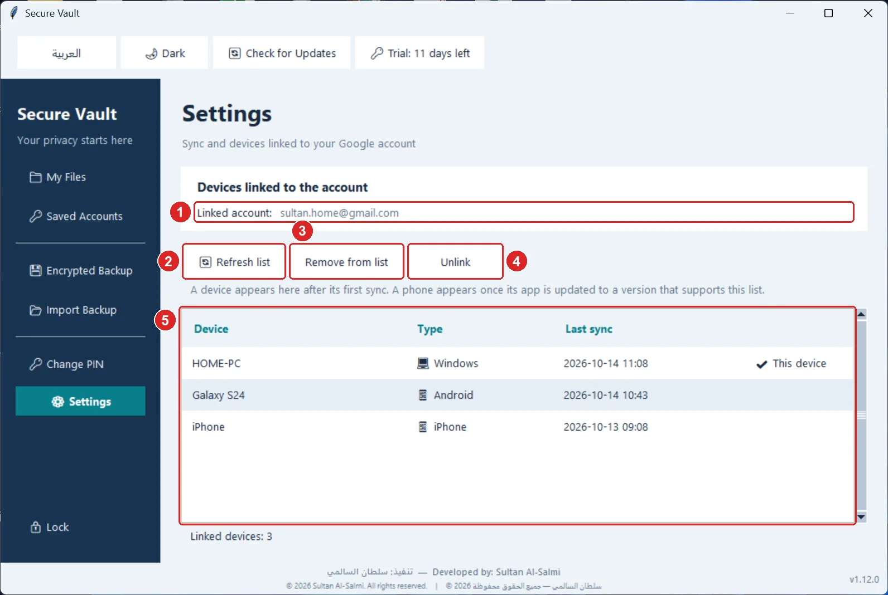

1. The Google account linked to this vault.
2. “Refresh list”.
3. “Remove from list”: clean up an old device you no longer use.
4. “Unlink”: stops this device from syncing (after two confirmations).
5. The devices: name, type (Windows/Android/iPhone) and last sync, with “This device” marked.

> **Tips:**
> - Removing a device from the list doesn't unlink it; if it's still linked it comes back after its next sync.

[↑ Back to contents](#contents)

---

## 10. Backup and restore

Keep a backup of your whole vault (files and accounts) in a single file, on a USB stick or another disk.

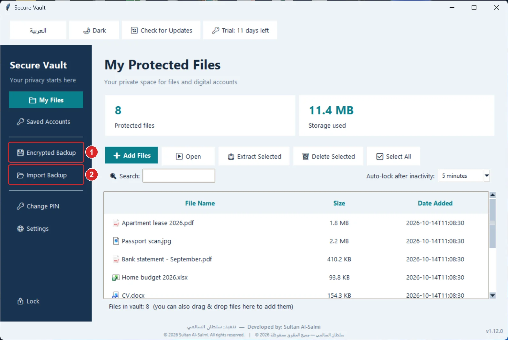

1. “Encrypted Backup” saves the whole vault into a ZIP file that stays encrypted and only opens with your PIN.
2. “Import Backup” replaces the current vault with the backup's content (after a confirmation), then locks so you open it with the backup's PIN.

> **Tips:**
> - On a new computer: on the create screen press “I have a backup to restore”.
> - A backup also opens in the phone app, and the other way round.
> - The Google sync link is not part of a backup — link again after restoring.

[↑ Back to contents](#contents)

---

## 11. Changing the PIN and the recovery key

From “Change PIN” in the sidebar.

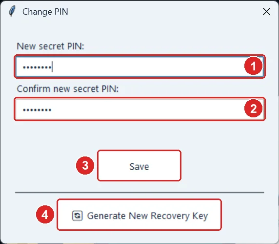

1. The new secret PIN.
2. Confirm the new PIN.
3. “Save”.
4. “Generate New Recovery Key”: if you lost the old key or think someone saw it. The old one stops working immediately.

> **Tips:**
> - Changing the PIN is instant, doesn't re-encrypt your files and doesn't change the recovery key.

[↑ Back to contents](#contents)

---

## 12. Top bar: language, dark mode, updates

The top-bar buttons are on every screen.

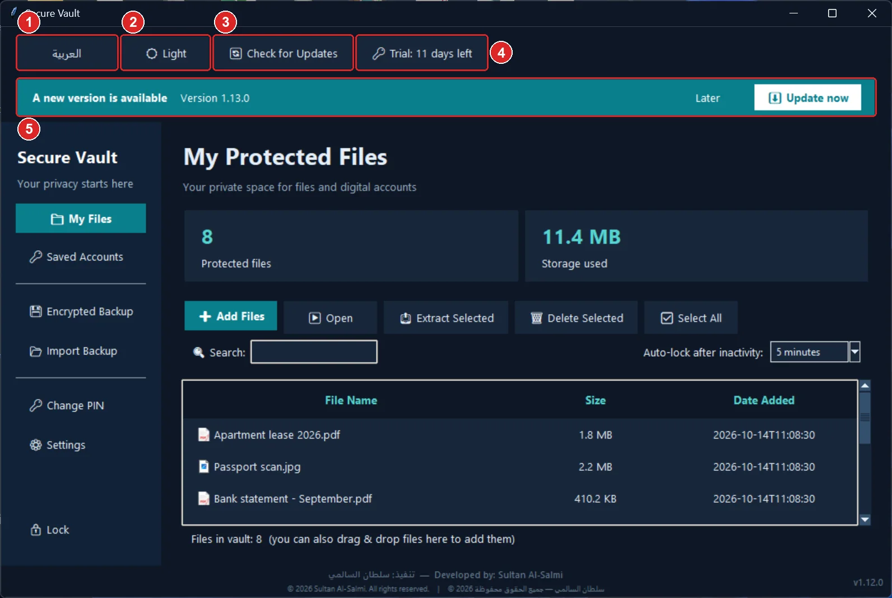

1. Switch the program language between Arabic and English.
2. Dark / light mode.
3. “Check for Updates” manually.
4. “License”: activation status and trial days left.
5. New-version alert: appears automatically. “Update now” downloads and installs the new version and reopens the program, keeping your data. “Later” hides it.

> **Tips:**
> - The program checks for updates at startup and every 6 hours while it's open.

[↑ Back to contents](#contents)

---

## 13. License and free trial

The program runs a 14-day trial with every feature. After that only *adding* (files, accounts, imports, sync) needs activation; opening, extracting and backing up your files and accounts always works — you're never locked out of your data.

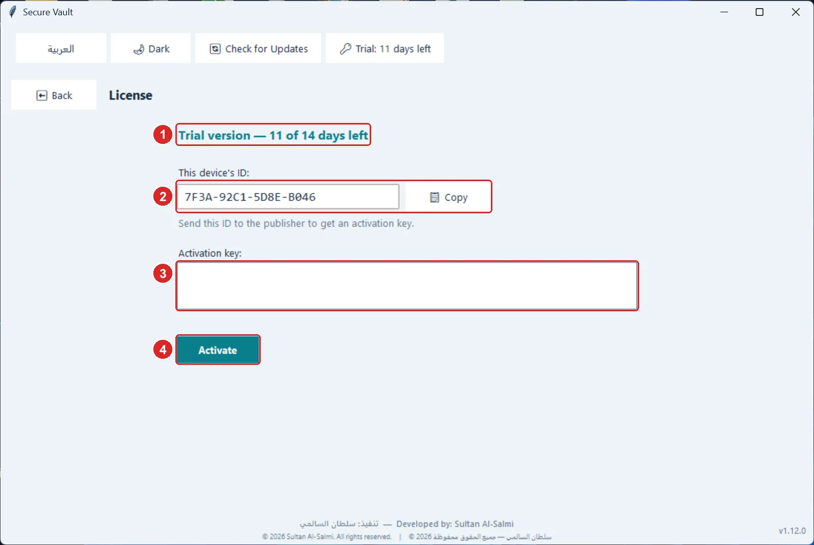

1. License status and days left.
2. This device's ID: press “Copy” and send it to the publisher to get an activation key.
3. Paste the activation key here.
4. Press “Activate”.

[↑ Back to contents](#contents)

---

## 14. The phone app (Android and iPhone)

The Secure Vault phone app is free and uses the same encryption format: a backup from the computer opens on the phone and vice versa, and saved accounts sync automatically through Google Drive. The installers are on the same release page: an APK for Android (arm64 for most modern phones) and an ipa for iPhone, installed with Sideloadly. The app alerts you to updates; Android updates in-app, iPhone opens the release page.

[↑ Back to contents](#contents)

---

## 15. Security: how your data is protected

A summary of what the program does to protect your data:

> **Tips:**
> - Every file is encrypted with AES-256 plus an HMAC that detects tampering, and the vault key is derived from your PIN with PBKDF2 (200,000 iterations).
> - File names and passwords are encrypted too; the vault folder only holds randomly named files.
> - Original files are overwritten before deletion, so undelete tools can't recover them.
> - Auto-lock, waiting after wrong attempts, and clearing a copied password after 45 seconds.

[↑ Back to contents](#contents)

---

© Sultan Al-Salmi — All rights reserved · © سلطان السالمي — جميع الحقوق محفوظة
