

# دليل استخدام برنامج المحفظة الآمنة

[English](GUIDE.en.md) · [نسخة PDF للطباعة](GUIDE-ar.pdf) · [تنزيل البرنامج](README.md)

شرح مفصّل بالصور لكل خصائص برنامج المحفظة الآمنة على ويندوز: إخفاء الملفات وتشفيرها، حفظ كلمات المرور، المزامنة مع الجوال، النسخ الاحتياطي، والإعدادات. الأرقام الحمراء في كل صورة تطابق الخطوات المكتوبة تحتها.

## المحتويات

1. [ما هو البرنامج؟](#about)
2. [أول تشغيل: إنشاء المحفظة](#setup)
3. [فتح المحفظة](#unlock)
4. [الشاشة الرئيسية: ملفاتي](#files)
5. [مشغّل الفيديو والصوت المدمج](#player)
6. [الحسابات المحفوظة (كلمات المرور)](#accounts)
7. [إضافة حساب أو تعديله](#account_edit)
8. [مزامنة الحسابات مع الجوال](#sync)
9. [الإعدادات والأجهزة المرتبطة](#settings)
10. [النسخ الاحتياطي والاستعادة](#backup)
11. [تغيير الرمز السري ومفتاح الاسترجاع](#pin)
12. [الشريط العلوي: اللغة، الوضع الداكن، التحديثات](#topbar)
13. [الترخيص والفترة التجريبية](#license)
14. [تطبيق الجوال (أندرويد وآيفون)](#mobile)
15. [الأمان: كيف تُحمى بياناتك](#security)

## 1. ما هو البرنامج؟

المحفظة الآمنة مكان خاص ومشفّر على جهازك لملفاتك وكلمات مرورك. كل ما تضيفه يُشفَّر بخوارزمية AES-256 ويُخفى داخل مجلد المحفظة، ولا يُفتح إلا برمزك السري. البرنامج يعمل بدون إنترنت ولا يرفع ملفاتك إلى أي مكان؛ الإنترنت يُستخدم فقط للتحقق من التحديثات، ولمزامنة الحسابات المحفوظة (اختيارياً) مع تطبيق الجوال.

> **نصائح:**
> - متوفر بنسختين: مثبّت (Setup) ونسخة محمولة (Portable) تعمل من أي مجلد أو فلاشة — كلتاهما بنفس المزايا.
> - لا يحتاج جهازك إلى تثبيت بايثون أو أي برنامج آخر.

[↑ العودة إلى المحتويات](#contents)

---

## 2. أول تشغيل: إنشاء المحفظة

عند تشغيل البرنامج أول مرة يطلب منك إنشاء رمز سري للمحفظة.

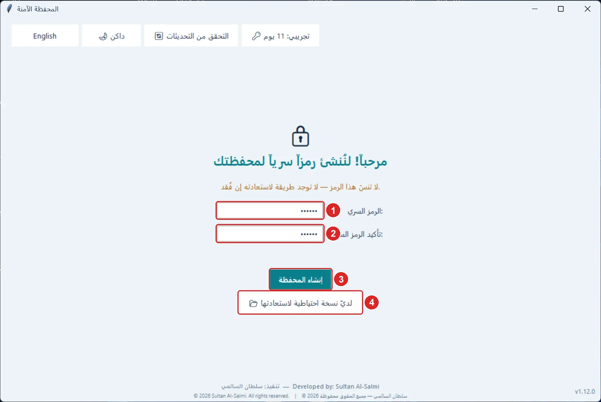

1. اكتب رمزاً سرياً (4 أحرف أو أرقام على الأقل؛ الأطول أقوى).
2. اكتب الرمز نفسه مرة ثانية للتأكيد.
3. اضغط «إنشاء المحفظة».
4. إن كانت لديك نسخة احتياطية من محفظة سابقة، اضغط «لديّ نسخة احتياطية لاستعادتها» بدلاً من إنشاء محفظة جديدة.

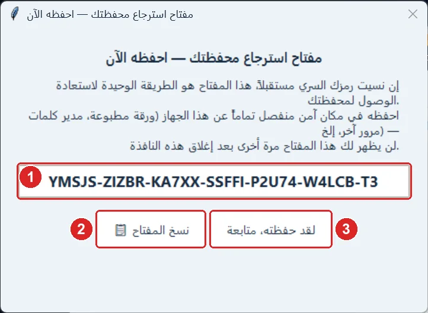

1. هذا هو «مفتاح الاسترجاع» — الطريقة الوحيدة لفتح المحفظة إن نسيت رمزك السري.
2. اضغط «نسخ المفتاح» واحفظه في مكان آمن بعيداً عن هذا الجهاز (ورقة مطبوعة أو مدير كلمات مرور آخر).
3. اضغط «لقد حفظته، متابعة». لن يظهر المفتاح مرة أخرى.

> **نصائح:**
> - لا توجد أي طريقة لفتح المحفظة بدون الرمز السري أو مفتاح الاسترجاع — حتى الناشر لا يستطيع.

[↑ العودة إلى المحتويات](#contents)

---

## 3. فتح المحفظة

في كل مرة تفتح البرنامج (أو بعد القفل) تظهر شاشة الدخول.

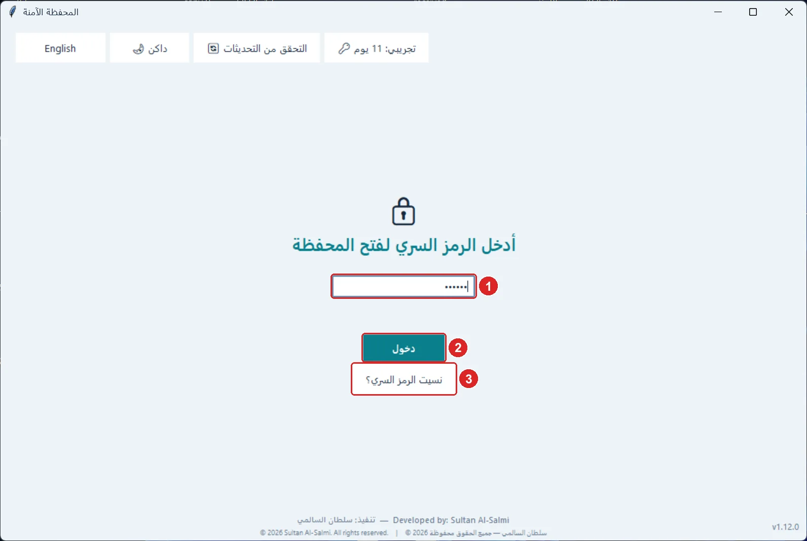

1. اكتب رمزك السري.
2. اضغط «دخول» (أو مفتاح Enter).
3. نسيت الرمز؟ اضغط «نسيت الرمز السري؟» وأدخل مفتاح الاسترجاع، ثم عيّن رمزاً سرياً جديداً.

> **نصائح:**
> - بعد 3 محاولات خاطئة يطلب البرنامج الانتظار ثوانيَ تزداد مع كل خطأ، لحماية المحفظة من التخمين.

[↑ العودة إلى المحتويات](#contents)

---

## 4. الشاشة الرئيسية: ملفاتي

هنا تُخفي ملفاتك داخل المحفظة وتفتحها وتستخرجها. الشريط الجانبي هو نفسه في كل الشاشات.

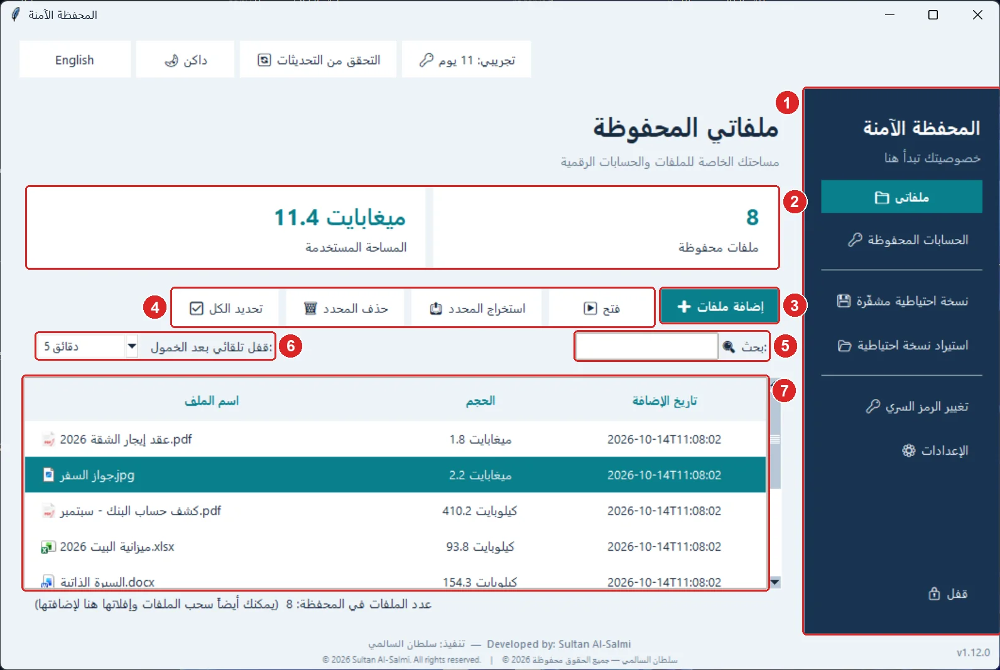

1. الشريط الجانبي: التنقّل بين «ملفاتي» و«الحسابات المحفوظة» و«الإعدادات»، والنسخ الاحتياطي، وتغيير الرمز السري، والقفل.
2. عدد الملفات المحفوظة والمساحة التي تشغلها.
3. «إضافة ملفات»: اختر ملفاً أو أكثر لتشفيره وإخفائه. يمكنك أيضاً سحب الملفات من المستكشف وإفلاتها على النافذة.
4. «فتح» الملف المحدد، و«استخراج المحدد» لإخراج نسخة عادية منه إلى مجلد تختاره، و«حذف المحدد» لحذفه نهائياً، و«تحديد الكل».
5. البحث باسم الملف.
6. القفل التلقائي: تُقفل المحفظة وحدها بعد مدة الخمول التي تختارها (دقيقة، 5 دقائق، 15 دقيقة، أو إيقاف).
7. قائمة الملفات: انقر نقراً مزدوجاً على ملف لفتحه، واضغط عنوان أي عمود للترتيب حسبه.

> **نصائح:**
> - عند الإضافة يسألك البرنامج: هل يحذف الملفات الأصلية من مكانها؟ اختر «نعم» ليبقى الملف داخل المحفظة فقط (يُكتب فوقه قبل حذفه فلا يمكن استرجاعه ببرامج الاسترجاع)، أو «لا» للاحتفاظ بنسخة ظاهرة أيضاً.
> - الملف الذي تفتحه يُفك تشفيره في نسخة مؤقتة؛ عند الضغط على «قفل» تُغلق هذه النسخ وتُحذف تلقائياً — احفظ تعديلاتك قبل القفل.
> - تحديد عدة ملفات: Ctrl أو Shift مع النقر، أو Ctrl+A.

[↑ العودة إلى المحتويات](#contents)

---

## 5. مشغّل الفيديو والصوت المدمج

الفيديو والصوت يُعرضان داخل نافذة المحفظة نفسها، فلا تُترك نسخة منهما في برامج أخرى.

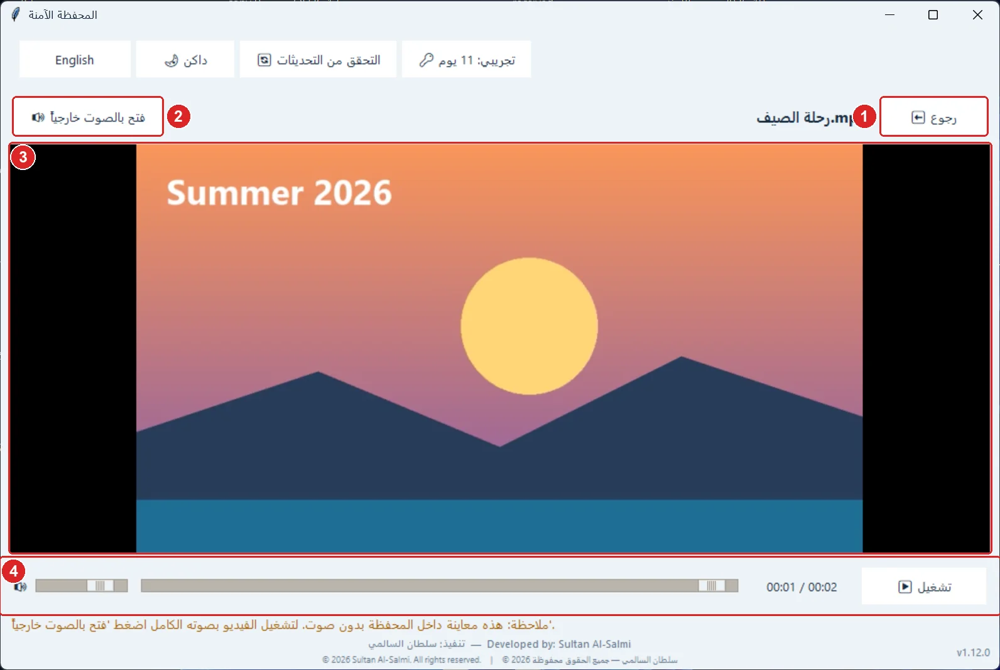

1. «رجوع» يغلق المشغّل ويحذف النسخة المؤقتة ويعيدك إلى الملفات.
2. «فتح بالصوت خارجياً»: يفتح الفيديو في مشغّل ويندوز بصوته الكامل.
3. الفيديو يُعرض هنا (معاينة بدون صوت).
4. شريط التحكم: «تشغيل/إيقاف مؤقت»، وشريط التقدّم للانتقال إلى أي لحظة، والوقت، ومستوى الصوت.

> **نصائح:**
> - ملفات الصوت (MP3 وغيرها) تُشغَّل داخل المحفظة بصوتها.
> - الصور والمستندات تُفتح بالبرنامج المرتبط بنوعها في ويندوز.

[↑ العودة إلى المحتويات](#contents)

---

## 6. الحسابات المحفوظة (كلمات المرور)

احفظ حسابات المواقع والتطبيقات وكلمات مرورها مشفّرة داخل المحفظة.

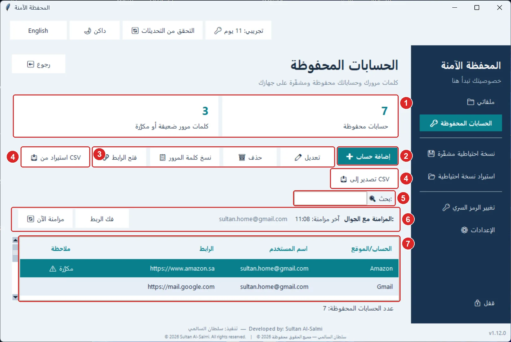

1. عدد الحسابات، وعدد كلمات المرور الضعيفة أو المستخدمة في أكثر من حساب.
2. «إضافة حساب».
3. للحساب المحدد: «تعديل»، «حذف»، «نسخ كلمة المرور» (تُمسح من الحافظة تلقائياً بعد 45 ثانية)، و«فتح الرابط» في المتصفح.
4. «استيراد من CSV» من متصفح أو برنامج كلمات مرور آخر، و«تصدير إلى CSV».
5. البحث في اسم الحساب واسم المستخدم والرابط.
6. المزامنة مع الجوال: حالتها، و«مزامنة الآن»، و«فك الربط» (انظر قسم المزامنة).
7. قائمة الحسابات: انقر نقراً مزدوجاً للتعديل. عمود «ملاحظة» ينبّهك إلى كلمة مرور ضعيفة أو مكرّرة.

> **نصائح:**
> - ملف CSV المصدَّر غير مشفّر وكلمات المرور فيه مقروءة — استخدمه للنقل فقط ثم احذفه.
> - الاستيراد يقبل ملفات Chrome و Edge و Firefox وأغلب برامج كلمات المرور.

[↑ العودة إلى المحتويات](#contents)

---

## 7. إضافة حساب أو تعديله

تظهر هذه الشاشة عند «إضافة حساب» أو «تعديل».

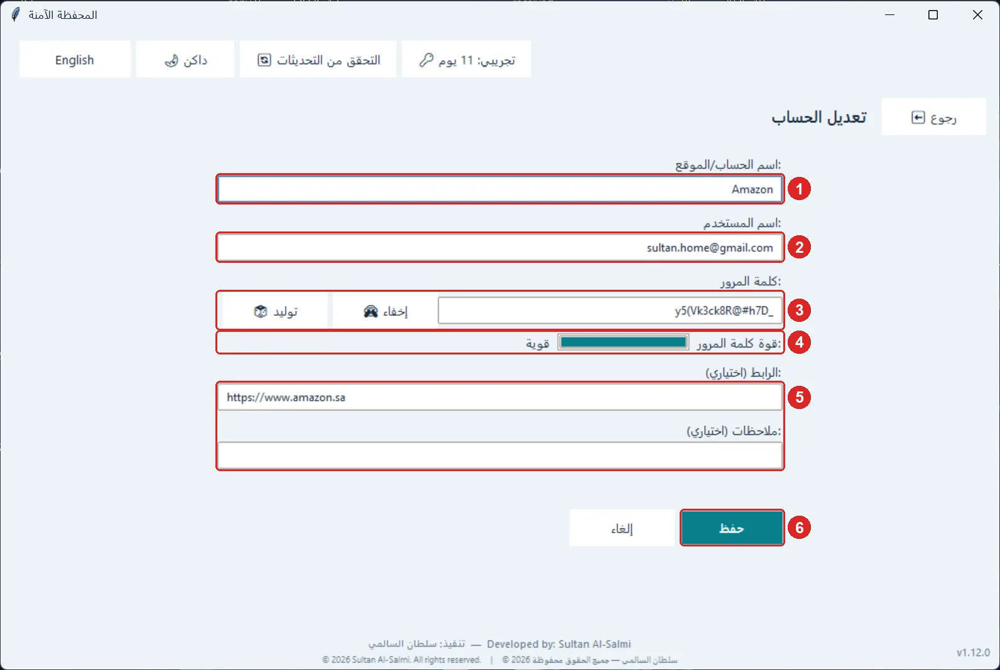

1. اسم الحساب أو الموقع (مطلوب).
2. اسم المستخدم أو البريد.
3. كلمة المرور: «إظهار» لرؤيتها، و«توليد» لإنشاء كلمة مرور قوية عشوائية.
4. مؤشر قوة كلمة المرور.
5. الرابط والملاحظات (اختياريان).
6. «حفظ».

[↑ العودة إلى المحتويات](#contents)

---

## 8. مزامنة الحسابات مع الجوال

تُزامَن الحسابات المحفوظة فقط (لا الملفات) بين البرنامج وتطبيق المحفظة الآمنة على الجوال عبر ملف واحد مشفّر في Google Drive الخاص بك. الربط يتم مرة واحدة من شاشة «الحسابات المحفوظة» ← «ربط حساب جوجل».

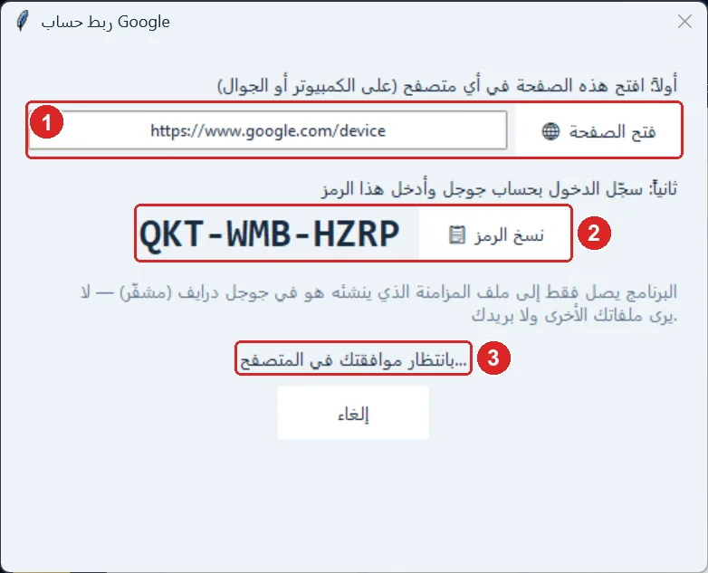

1. افتح هذه الصفحة في أي متصفح (تُفتح تلقائياً على الكمبيوتر).
2. سجّل الدخول بحساب Google وأدخل هذا الرمز (يُنسخ تلقائياً — الصقه فقط).
3. بعد موافقتك في المتصفح يكمل البرنامج وحده.

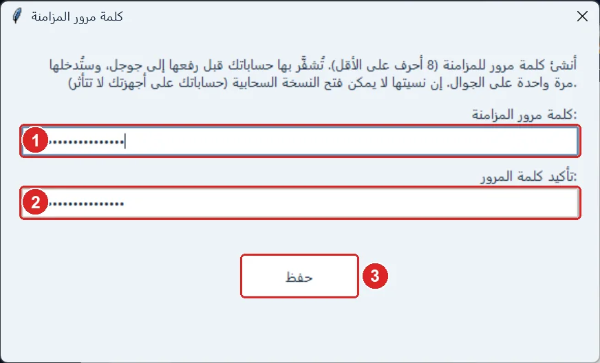

1. أنشئ «كلمة مرور المزامنة» (8 أحرف على الأقل). تُشفَّر بها حساباتك قبل رفعها.
2. اكتبها مرة ثانية للتأكيد.
3. اضغط «حفظ». على الجوال تربط نفس حساب Google وتدخل نفس كلمة مرور المزامنة مرة واحدة.

> **نصائح:**
> - البرنامج يصل فقط إلى ملف المزامنة الذي ينشئه هو، ولا يرى ملفاتك الأخرى في Drive ولا بريدك.
> - Google لا يرى إلا بيانات مشفّرة. إن نسيت كلمة مرور المزامنة لا يمكن فتح النسخة السحابية، لكن حساباتك على أجهزتك لا تتأثر.
> - المزامنة تعمل تلقائياً بعد كل تعديل وكل 5 دقائق ما دامت المحفظة مفتوحة. التعديل الأحدث يفوز، والمحذوف لا يعود.
> - «فك الربط» يطلب تأكيدين لأنه يوقف المزامنة بين أجهزتك.

[↑ العودة إلى المحتويات](#contents)

---

## 9. الإعدادات والأجهزة المرتبطة

من «⚙ الإعدادات» في الشريط الجانبي ترى كل الأجهزة المرتبطة بحساب المزامنة.

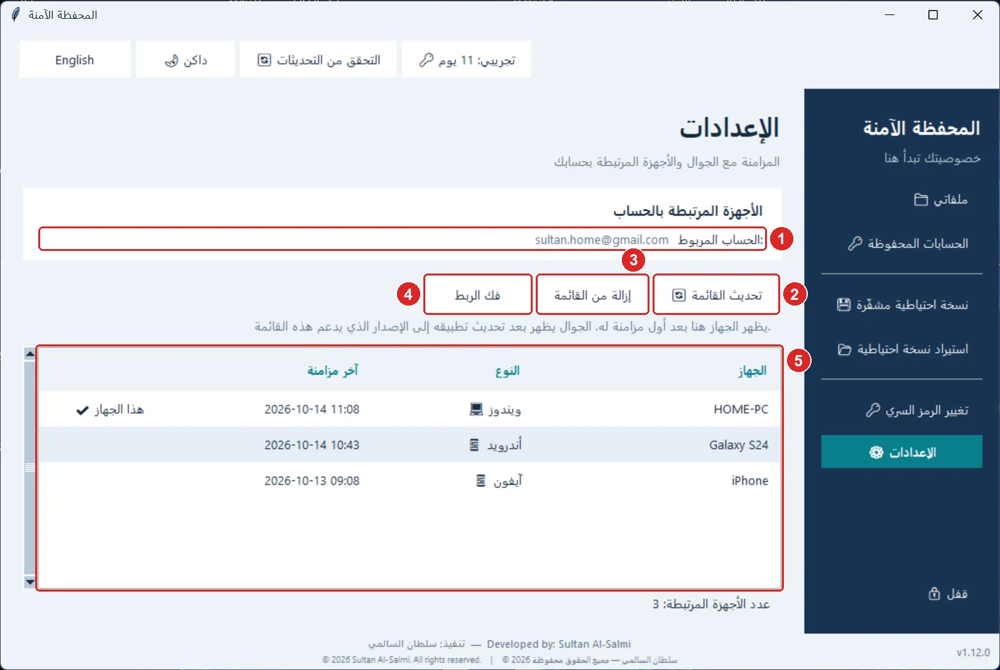

1. حساب Google المربوط بهذه المحفظة.
2. «تحديث القائمة».
3. «إزالة من القائمة»: لتنظيف جهاز قديم لم تعد تستخدمه.
4. «فك الربط»: يوقف مزامنة هذا الجهاز (بعد تأكيدين).
5. الأجهزة: الاسم، النوع (ويندوز/أندرويد/آيفون)، وآخر مزامنة، مع علامة «هذا الجهاز».

> **نصائح:**
> - إزالة جهاز من القائمة لا تفك ربطه؛ إن كان ما زال مربوطاً يعود بعد مزامنته التالية.

[↑ العودة إلى المحتويات](#contents)

---

## 10. النسخ الاحتياطي والاستعادة

احتفظ بنسخة احتياطية من محفظتك كلها (الملفات والحسابات) في ملف واحد، على فلاشة أو قرص آخر.

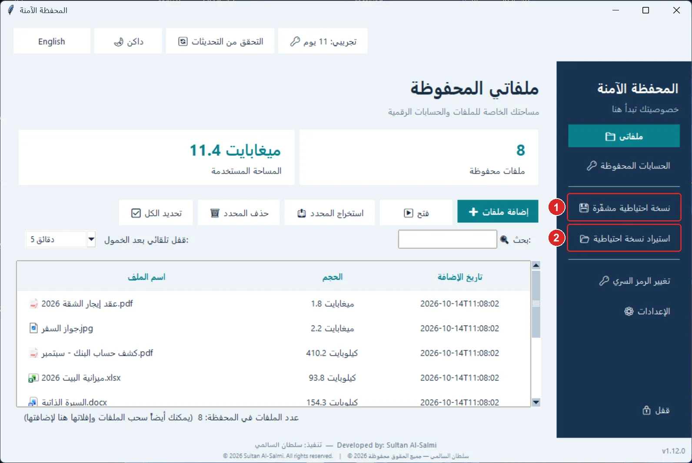

1. «نسخة احتياطية مشفّرة»: يحفظ المحفظة كلها في ملف ZIP يبقى مشفّراً ولا يُفتح إلا برمزك السري.
2. «استيراد نسخة احتياطية»: يستبدل محتوى المحفظة الحالية بمحتوى النسخة (بعد تأكيد)، ثم تُقفل لتفتحها برمز النسخة.

> **نصائح:**
> - على جهاز جديد: في شاشة الإنشاء اضغط «لديّ نسخة احتياطية لاستعادتها».
> - النسخة الاحتياطية تُفتح أيضاً في تطبيق الجوال، والعكس.
> - ربط حساب Google لا يدخل في النسخة الاحتياطية — تربطه من جديد بعد الاستعادة.

[↑ العودة إلى المحتويات](#contents)

---

## 11. تغيير الرمز السري ومفتاح الاسترجاع

من «تغيير الرمز السري» في الشريط الجانبي.

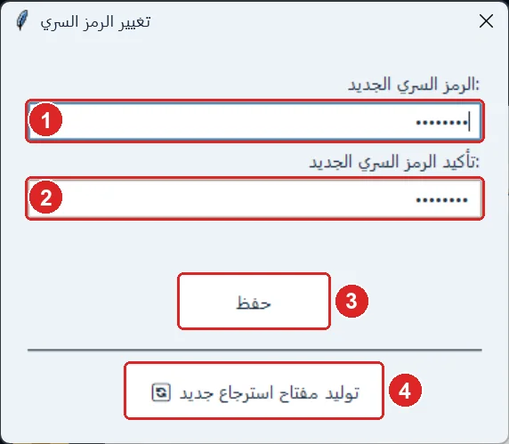

1. الرمز السري الجديد.
2. تأكيد الرمز الجديد.
3. «حفظ».
4. «توليد مفتاح استرجاع جديد»: إن فقدت مفتاحك القديم أو شككت أن أحداً رآه. القديم يتوقف عن العمل فوراً.

> **نصائح:**
> - تغيير الرمز السري سريع ولا يعيد تشفير ملفاتك، ولا يغيّر مفتاح الاسترجاع.

[↑ العودة إلى المحتويات](#contents)

---

## 12. الشريط العلوي: اللغة، الوضع الداكن، التحديثات

أزرار الشريط العلوي تظهر في كل الشاشات.

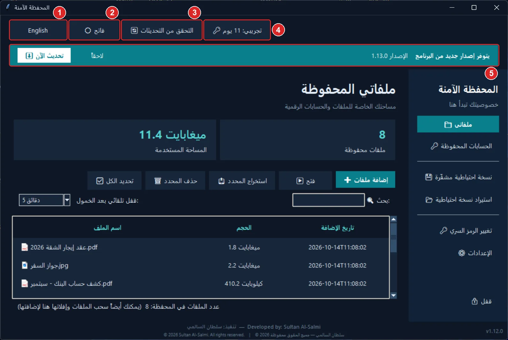

1. تبديل لغة البرنامج بين العربية والإنجليزية.
2. الوضع الداكن / الفاتح.
3. «التحقق من التحديثات» يدوياً.
4. «الترخيص»: حالة التفعيل والأيام المتبقية من التجربة.
5. تنبيه إصدار جديد: يظهر تلقائياً. «تحديث الآن» ينزّل الإصدار الجديد ويثبّته ويعيد فتح البرنامج، وتبقى بياناتك كما هي. «لاحقاً» يخفيه.

> **نصائح:**
> - يفحص البرنامج وجود تحديث عند التشغيل ثم كل 6 ساعات ما دام مفتوحاً.

[↑ العودة إلى المحتويات](#contents)

---

## 13. الترخيص والفترة التجريبية

البرنامج يعمل 14 يوماً تجريبية بكل المزايا. بعدها تحتاج «الإضافة» فقط (ملفات، حسابات، استيراد، مزامنة) إلى تفعيل، أما فتح ملفاتك وحساباتك واستخراجها ونسخها احتياطياً فمتاح دائماً — لا تُحبس عن بياناتك.

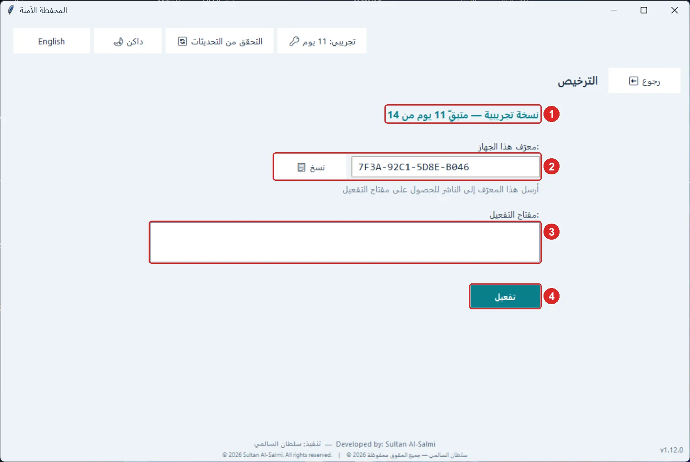

1. حالة الترخيص والأيام المتبقية.
2. معرّف هذا الجهاز: اضغط «نسخ» وأرسله إلى الناشر للحصول على مفتاح التفعيل.
3. الصق مفتاح التفعيل هنا.
4. اضغط «تفعيل».

[↑ العودة إلى المحتويات](#contents)

---

## 14. تطبيق الجوال (أندرويد وآيفون)

تطبيق المحفظة الآمنة للجوال مجاني، بنفس صيغة التشفير: النسخة الاحتياطية من الكمبيوتر تُفتح على الجوال والعكس، والحسابات المحفوظة تُزامَن تلقائياً عبر Google Drive. ملفات التثبيت في صفحة الإصدار نفسها: لأندرويد ملف APK (arm64 لأغلب الهواتف الحديثة)، ولآيفون ملف ipa يُثبَّت عبر Sideloadly. التطبيق ينبّهك بالتحديثات؛ أندرويد يتحدّث من داخل التطبيق، وآيفون يفتح صفحة الإصدار.

[↑ العودة إلى المحتويات](#contents)

---

## 15. الأمان: كيف تُحمى بياناتك

ملخّص لما يفعله البرنامج لحماية بياناتك:

> **نصائح:**
> - كل ملف يُشفَّر بـ AES-256 مع بصمة HMAC تكشف أي عبث، ومفتاح المحفظة مشتق من رمزك السري بـ PBKDF2 (200,000 تكرار).
> - أسماء الملفات وكلمات المرور مشفّرة أيضاً؛ ولا يظهر في مجلد المحفظة إلا ملفات بأسماء عشوائية.
> - حذف الملفات الأصلية يتم بالكتابة فوقها أولاً، فلا تُسترجع ببرامج استرجاع المحذوفات.
> - القفل التلقائي، والانتظار بعد المحاولات الخاطئة، ومسح كلمة المرور من الحافظة بعد 45 ثانية.

[↑ العودة إلى المحتويات](#contents)

---

© سلطان السالمي — جميع الحقوق محفوظة · © Sultan Al-Salmi — All rights reserved

