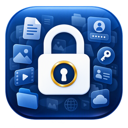

# المحفظة الآمنة — Secure Vault

**خزنتك الشخصية المشفّرة للملفات والحسابات الرقمية — على ويندوز وأندرويد والآيفون**
 
**Your personal encrypted vault for files and digital accounts — on Windows, Android and iPhone**

[العربية](#العربية) · [English](#english) · [صفحة الإصدار / Release page](https://github.com/ssmm6000/SecureVault-Releases/releases/tag/v1.12.0)

---

## ⬇ التنزيل — Download

كل الملفات في صفحة إصدار واحدة: **[v1.12.0](https://github.com/ssmm6000/SecureVault-Releases/releases/tag/v1.12.0)** (2026-10-14) · All files are on a single release page.

| المنصة / Platform | الملف / File | الوصف | Description |
|---|---|---|---|
| 🪟 **Windows 1.12.0** | [**SecureVault-Setup-1.12.0.exe**](https://github.com/ssmm6000/SecureVault-Releases/releases/download/v1.12.0/SecureVault-Setup-1.12.0.exe) | النسخة المثبّتة (موصى بها) | Installed edition (recommended) |
| 🪟 **Windows 1.12.0** | [**SecureVault_Portable-1.12.0.zip**](https://github.com/ssmm6000/SecureVault-Releases/releases/download/v1.12.0/SecureVault_Portable-1.12.0.zip) | النسخة المحمولة: تعمل من فلاش أو هارد خارجي دون تثبيت | Portable: runs from a USB drive with no installation |
| 🤖 **Android 1.3.0** | [**SecureVault-Android-1.3.0-arm64.apk**](https://github.com/ssmm6000/SecureVault-Releases/releases/download/v1.12.0/SecureVault-Android-1.3.0-arm64.apk) | لأغلب الهواتف الحديثة | Most modern phones |
| 🤖 **Android 1.3.0** | [SecureVault-Android-1.3.0-arm32.apk](https://github.com/ssmm6000/SecureVault-Releases/releases/download/v1.12.0/SecureVault-Android-1.3.0-arm32.apk) | للهواتف القديمة | Older phones |
| 🤖 **Android 1.3.0** | [SecureVault-Android-1.3.0-universal.apk](https://github.com/ssmm6000/SecureVault-Releases/releases/download/v1.12.0/SecureVault-Android-1.3.0-universal.apk) | يعمل على أي هاتف (حجم أكبر) | Any phone (larger file) |
| 🍎 **iPhone 1.3.0** | [**SecureVault-iOS-1.3.0-unsigned.ipa**](https://github.com/ssmm6000/SecureVault-Releases/releases/download/v1.12.0/SecureVault-iOS-1.3.0-unsigned.ipa) | يُثبَّت من الكمبيوتر عبر Sideloadly ([الخطوات](#التثبيت)) | Installed from a PC with Sideloadly ([steps](#installation)) |

> نسخة ويندوز تعمل **14 يوماً تجريبية** بكل المزايا، ثم تحتاج مفتاح تفعيل لإضافة ملفات أو حسابات جديدة (ملفاتك الموجودة تبقى قابلة للفتح والاستخراج دائماً). تطبيقا أندرويد والآيفون مجانيان.
>  
> The Windows program has a **14-day full trial**, then needs an activation key to add new files or accounts (your existing files can always be opened and extracted). The Android and iPhone apps are free.

### الجديد في هذا الإصدار — What's new

## الجديد — ويندوز 1.12.0 / أندرويد وآيفون 1.3.0

### ويندوز
- **شاشة الإعدادات (⚙):** تعرض حساب Google المربوط وقائمة **الأجهزة المرتبطة بالحساب** (اسم الجهاز، نوعه، آخر مزامنة، وعلامة "هذا الجهاز")، مع تحديث القائمة وإزالة جهاز قديم منها.
- **فك الربط بتأكيدين:** يُنبَّه المستخدم مرتين بأن فك الربط قد يلغي المزامنة بين أجهزته قبل تنفيذه، ويُحذف الجهاز من قائمة الأجهزة المرتبطة.
- **شاشة الحسابات المحفوظة بتصميم جديد** مطابق لشاشة الملفات: شريط جانبي، بطاقتا إحصاءات (عدد الحسابات، وكلمات المرور الضعيفة أو المكرّرة)، وشريط أزرار — مع بقاء كل الأزرار السابقة.
- **تنبيه التحديثات:** يفحص البرنامج وجود إصدار جديد عند التشغيل ثم كل 6 ساعات ما دام مفتوحاً، ويمكن التحديث بضغطة من داخل البرنامج.

### الجوال
- الهاتف يظهر في قائمة الأجهزة المرتبطة في برنامج ويندوز.
- فك الربط بتأكيدين.
- فحص التحديثات أيضاً عند العودة للتطبيق (بعد 6 ساعات من آخر فحص). أندرويد يتحدّث من داخل التطبيق؛ آيفون يفتح صفحة الإصدار (قيد من Apple لتطبيقات Sideloadly).

---

## What's new — Windows 1.12.0 / Android & iPhone 1.3.0

### Windows
- **Settings screen (⚙):** shows the linked Google account and the **devices linked to the account** (name, type, last sync, "this device"), with refresh and removing an old device from the list.
- **Unlink asks twice:** you're warned twice that unlinking may stop syncing between your devices, and the device is removed from the linked devices list.
- **Redesigned Saved Accounts screen** matching the Files screen: sidebar, two stat cards (accounts, weak or reused passwords) and a button bar — every previous button kept.
- **Update alerts:** the program checks for a new version at startup and every 6 hours while open, and updates itself in one click.

### Mobile
- The phone now appears in the linked devices list on Windows.
- Unlink asks twice.
- Update check also when returning to the app (6 hours after the last check). Android updates in-app; iPhone opens the release page (an Apple restriction for Sideloadly apps).

© Sultan Al-Salmi — All rights reserved / © سلطان السالمي — جميع الحقوق محفوظة

---

## العربية

### ما هي المحفظة الآمنة؟

**المحفظة الآمنة** برنامج يحفظ ملفاتك الخاصة وبيانات حساباتك الرقمية **مشفّرةً على جهازك أنت فقط**. لا يمكن فتح المحفظة إلا بالرمز السري الذي تختاره (أو ببصمتك على الهاتف).

### لماذا تستخدمها؟

- 📁 **إخفاء الملفات الخاصة:** مستندات شخصية، عقود، صور، فيديوهات، تسجيلات صوتية — أي نوع ملف.
- 🔑 **حفظ الحسابات الرقمية في مكان واحد:** اشتراكات البرامج والخدمات، حسابات البريد الإلكتروني، مواقع التواصل، البنوك والمتاجر.
- 💻📱 **على الكمبيوتر والهاتف:** مزامنة الحسابات المحفوظة بين ويندوز والجوال، والنسخة الاحتياطية تُفتح على الأجهزة الثلاثة.
- 🧳 **محمولة:** نسخة ويندوز المحمولة تعمل من فلاش ميموري على أي جهاز، وبياناتك معك على القرص نفسه.

### المزايا

| | ويندوز | أندرويد | آيفون |
|---|:---:|:---:|:---:|
| تشفير الملفات (أي نوع وأي حجم) | ✅ | ✅ | ✅ |
| الحسابات المحفوظة + مولّد كلمات مرور قوية | ✅ | ✅ | ✅ |
| مزامنة الحسابات بين ويندوز والجوال (مشفّرة) | ✅ | ✅ | ✅ |
| استيراد وتصدير الحسابات (CSV) | ✅ | — | — |
| مفتاح استرجاع عند نسيان الرمز السري | ✅ | ✅ | ✅ |
| قفل تلقائي بعد عدم الاستخدام | ✅ | ✅ | ✅ |
| نسخ احتياطي واسترجاع (متوافق بين الأجهزة الثلاثة) | ✅ | ✅ | ✅ |
| مشغّل فيديو وصوت مدمج | ✅ | — | — |
| السحب والإفلات لإضافة الملفات | ✅ | — | — |
| حذف الأصل بعد إضافته وإرجاعه لاحقاً إلى مكانه | ✅ | ✅ | ✅ |
| الدخول بالبصمة (Face ID في الآيفون) | — | ✅ | ✅ |
| منع لقطات الشاشة | — | ✅ | — |
| التحديث من داخل البرنامج | ✅ | ✅ | تنبيه فقط |
| العربية والإنجليزية، الوضع الفاتح والداكن | ✅ | ✅ | ✅ |

### 🔐 الأمان والخصوصية

- **تشفير AES-256** لكل ملف، مع توقيع **HMAC-SHA256** يكشف أي تلف أو تلاعب.
- الرمز السري **لا يُخزَّن أبداً**؛ يُشتق منه مفتاح عبر **PBKDF2-SHA256 بـ 200,000 تكرار** لإبطاء محاولات التخمين.
- **مفتاح استرجاع** يُعرض مرة واحدة عند الإنشاء — الطريقة الوحيدة لفتح المحفظة إن نُسي الرمز. لا يوجد باب خلفي، ولا يستطيع المطوّر نفسه فتح محفظتك.
- **الملفات لا تُرفع أبداً.** الاتصال بالإنترنت فقط لقراءة رقم آخر إصدار من هذه الصفحة، ولمزامنة الحسابات إن فعّلتها (ملف واحد مشفّر بكلمة مرور مزامنة لا يعرفها غيرك، في Google Drive الخاص بك).

### التثبيت

**ويندوز — النسخة المثبّتة:** نزّل `SecureVault-Setup-<الإصدار>.exe` وشغّله، واختر اللغة في بدايته.

**ويندوز — النسخة المحمولة:** فك ضغط `SecureVault_Portable-<الإصدار>.zip` إلى أي مكان (فلاش مثلاً) وشغّل `SecureVault.exe`.

> - البرنامج يعمل **بصلاحيات المسؤول**: عند فتحه يظهر طلب ويندوز للسماح (UAC) — اضغط "نعم".
> - قد يظهر تحذير **Windows SmartScreen** لأن الملف غير موقّع رقمياً: اضغط "معلومات إضافية" ثم "تشغيل على أي حال".
> - **التفعيل:** زر 🔑 أعلى نافذة البرنامج يعرض "معرّف هذا الجهاز" — أرسله للناشر لتحصل على مفتاح التفعيل، ثم الصقه في نفس الشاشة.

**أندرويد:** نزّل ملف APK على الهاتف وافتحه، واسمح بالتثبيت من هذا المصدر عند السؤال. ملف `arm64` لأغلب الهواتف؛ إن ظهرت رسالة عدم توافق فاستخدم ملف `universal`. بعد ذلك تصلك التحديثات من داخل التطبيق.

> **إن منع الهاتف التثبيت:** اضغط "تنزيل على أي حال" إن حذّر المتصفح · فعّل "السماح من هذا المصدر" · في Play Protect اختر "مزيد من التفاصيل" ← "التثبيت على أي حال" · في سامسونج أوقف "الحظر التلقائي" (Auto Blocker) مؤقتاً.

**آيفون (بحساب Apple ID مجاني):** ملف `.ipa` غير موقّع، ويوقّعه برنامج **Sideloadly** بحسابك أثناء التثبيت:
1. على كمبيوتر ويندوز ثبّت [Sideloadly](https://sideloadly.io)، ومعه **iTunes** و**iCloud** من موقع Apple (ليس من متجر مايكروسوفت).
2. وصّل الآيفون بكابل واضغط **"الوثوق بهذا الكمبيوتر"** على الآيفون.
3. اسحب ملف `SecureVault-iOS-<الإصدار>-unsigned.ipa` إلى Sideloadly، واكتب بريد Apple ID، ثم **Start**.
4. على الآيفون: الإعدادات ← عام ← **إدارة VPN والجهاز** ← حسابك ← **وثوق**.
5. iOS 16 فأحدث: الإعدادات ← الخصوصية والأمان ← **وضع المطوّر** ← تفعيل، ثم أعد تشغيل الآيفون.

> مع الحساب المجاني ينتهي التوقيع بعد **7 أيام**؛ أعد التثبيت من Sideloadly، وتبقى محفظتك كما هي.

### التحديث

- **ويندوز:** يظهر تنبيه داخل البرنامج عند صدور إصدار جديد، وزر **"تحديث الآن"** ينزّله ويثبّته تلقائياً.
- **أندرويد:** يظهر تنبيه في التطبيق، و"تحديث الآن" ينزّل الملف ويفتح شاشة التثبيت. (الهواتف التي عليها 1.2.0 أو أقدم: نزّل الإصدار الجديد من هذه الصفحة مرة واحدة.)
- **في كل الحالات تبقى محفظتك وملفاتك كما هي** عند الترقية.

---

## English

### What is Secure Vault?

**Secure Vault** keeps your private files and digital account details **encrypted on your own device only**. The vault opens only with the secret PIN you choose (or your fingerprint on the phone).

### Why use it?

- 📁 **Hide private files:** personal documents, contracts, photos, videos, voice recordings — any file type.
- 🔑 **Keep your digital accounts in one place:** software and service subscriptions, email accounts, social media, banking and shopping.
- 💻📱 **On your PC and your phone:** saved accounts sync between Windows and the phone, and backups open on all three platforms.
- 🧳 **Portable:** the Windows portable edition runs from a USB drive on any PC, with your data on the drive itself.

### Features

| | Windows | Android | iPhone |
|---|:---:|:---:|:---:|
| File encryption (any type, any size) | ✅ | ✅ | ✅ |
| Saved accounts + strong-password generator | ✅ | ✅ | ✅ |
| Account sync between Windows and the phone (encrypted) | ✅ | ✅ | ✅ |
| Import and export accounts (CSV) | ✅ | — | — |
| Recovery key if you forget your PIN | ✅ | ✅ | ✅ |
| Auto-lock when idle | ✅ | ✅ | ✅ |
| Backup & restore (compatible across all three) | ✅ | ✅ | ✅ |
| Built-in video and audio player | ✅ | — | — |
| Drag & drop to add files | ✅ | — | — |
| Delete the original after adding, restore it later | ✅ | ✅ | ✅ |
| Fingerprint unlock (Face ID on iPhone) | — | ✅ | ✅ |
| Screenshot blocking | — | ✅ | — |
| In-app updates | ✅ | ✅ | notice only |
| Arabic & English, light & dark mode | ✅ | ✅ | ✅ |

### 🔐 Security & privacy

- **AES-256 encryption** for every file, with an **HMAC-SHA256** signature that detects any damage or tampering.
- Your PIN is **never stored**; a key is derived from it with **PBKDF2-SHA256 (200,000 iterations)** to slow down guessing.
- A **recovery key** is shown once when you create the vault — the only way in if you forget your PIN. There is no back door; not even the developer can open your vault.
- **Files are never uploaded.** The apps go online only to read the latest version number from this page, and to sync accounts if you turn it on (one file, encrypted with a sync password only you know, in your own Google Drive).

### Installation

**Windows — installed edition:** download `SecureVault-Setup-<version>.exe` and run it; pick the language at the start.

**Windows — portable edition:** unzip `SecureVault_Portable-<version>.zip` anywhere (e.g. a USB drive) and run `SecureVault.exe`.

> - The program runs **as administrator**: Windows shows a permission prompt (UAC) when you open it — click "Yes".
> - **Windows SmartScreen** may warn because the file isn't digitally signed: click "More info" → "Run anyway".
> - **Activation:** the 🔑 button at the top of the program shows "This device's ID" — send it to the publisher to get an activation key, then paste the key on the same screen.

**Android:** download the APK on your phone and open it; allow installs from this source when asked. `arm64` fits most phones; if the phone reports it as incompatible, use the `universal` file. Later updates arrive inside the app.

> **If the phone blocks the install:** tap "Download anyway" if the browser warns · allow "Install from this source" · in Play Protect choose "More details" → "Install anyway" · on Samsung, temporarily turn off "Auto Blocker".

**iPhone (free Apple ID):** the `.ipa` is unsigned; **Sideloadly** signs it with your account while installing:
1. On a Windows PC install [Sideloadly](https://sideloadly.io), plus **iTunes** and **iCloud** from Apple's website (not the Microsoft Store).
2. Connect the iPhone by cable and tap **"Trust This Computer"** on the iPhone.
3. Drag `SecureVault-iOS-<version>-unsigned.ipa` into Sideloadly, enter your Apple ID email, then **Start**.
4. On the iPhone: Settings → General → **VPN & Device Management** → your account → **Trust**.
5. iOS 16 or newer: Settings → Privacy & Security → **Developer Mode** → on, then restart the iPhone.

> With a free account the signature expires after **7 days**; reinstall from Sideloadly — your vault is kept.

### Updating

- **Windows:** a notice appears inside the program when a new version is out, and **"Update now"** downloads and installs it.
- **Android:** a notice appears in the app, and "Update now" downloads the file and opens the install screen. (Phones on 1.2.0 or older: download the new version from this page once.)
- **Your vault and files are always kept** when upgrading.

---

## ©️ الحقوق — Copyright

**© 2026 سلطان السالمي. جميع الحقوق محفوظة.**

برنامج "المحفظة الآمنة" (لويندوز وأندرويد والآيفون) من تطوير **سلطان السالمي**، وجميع حقوقه محفوظة له. لا يجوز نسخ البرنامج أو تعديله أو إعادة توزيعه أو بيعه أو نسبته لغير مطوّره دون إذن كتابي مسبق من المطوّر.

**© 2026 Sultan Al-Salmi. All rights reserved.**

"Secure Vault" (for Windows, Android and iPhone) was developed by **Sultan Al-Salmi**, who holds all rights to it. You may not copy, modify, redistribute, sell, or claim authorship of this software without prior written permission from the developer.
